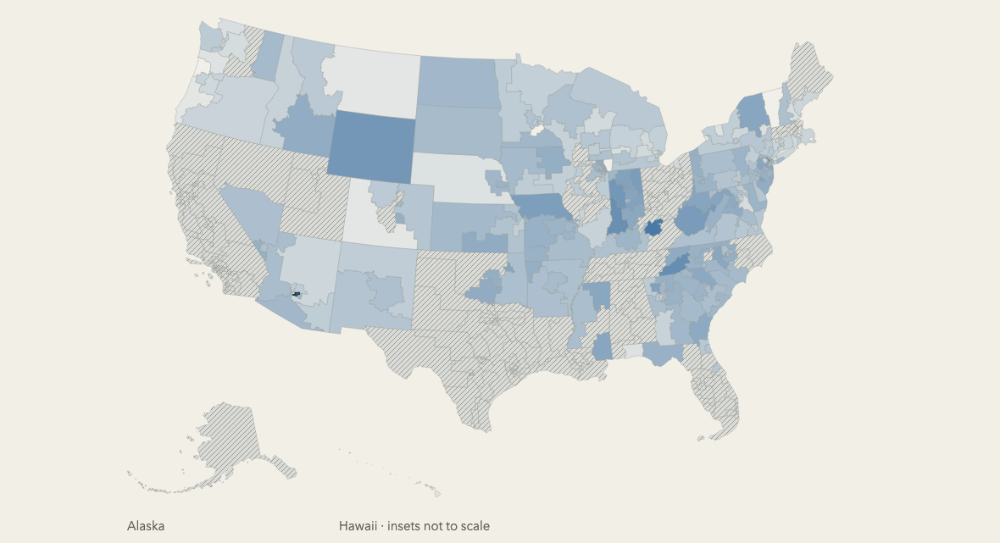
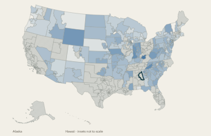
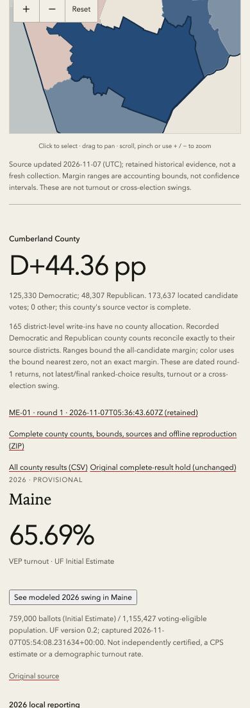
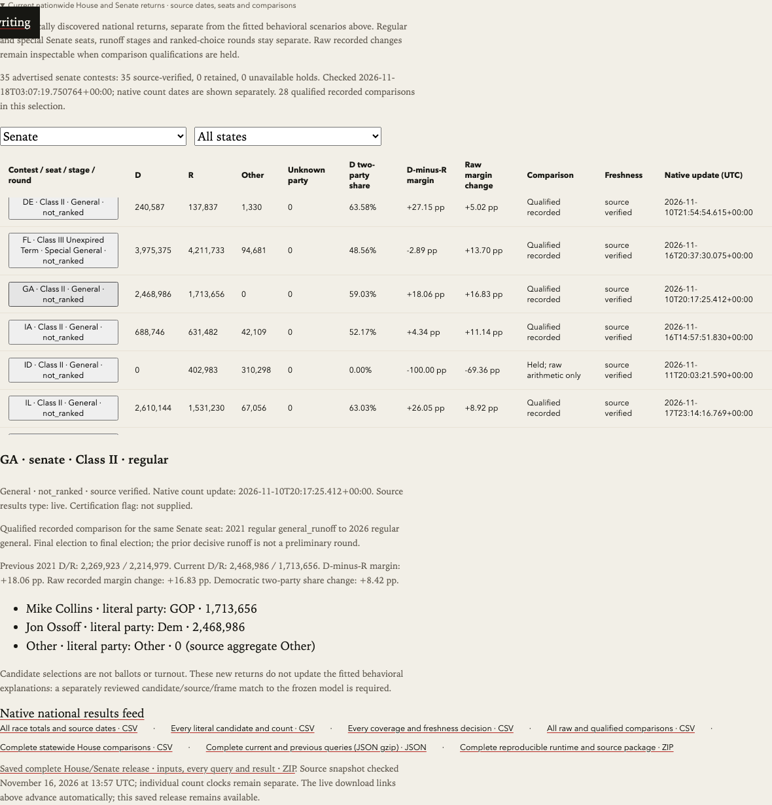

# Voter-participation: supported-product handoff, November 18, 2026

The source-to-analysis-to-explorer pipeline is operating, with complete reproducible
downloads. This is not a claim of universal precinct turnout, identified individual
behavior or scientific project completion. Counts below describe the accepted immutable
snapshot `0ae8bf1bb1400699808f9eab3f16fda40f9c9dfe7903ad18850f7a4cdbeb7cd0`, not a promise that a rolling source has not since changed.

## Coverage and actual delivery

| Product | Reported request baseline | Accepted outcome |
| --- | --- | --- |
| Refreshed House races | 428; seven retained | 435; zero retained |
| Refreshed Senate races | 35 | 35; zero retained |
| Automatic House states / nine-variant frames | 4 / 36 | 11 / 99 |
| Previously qualified frozen House states | 29 | 22 |
| Qualified district comparisons | 258 | 259; 176 held |
| Qualified House-state comparisons | 32 | 32 |
| Senate qualified exports / actual live reader | 28 / 25 reported | 28 / 28 verified |
| Maine retained round-one county D/R display | User reported missing | All 16 live, desktop and mobile |
| New district map | No all-district reader | All 435 **live**, desktop/mobile verified |

The one district increase is FL-05 recovering freshness, not newly proved boundary
equivalence. Display geometry does not itself qualify any comparison. The map uses
blue/red signed shifts for eligible comparisons and neutral hatches for holds;
missing/unqualified is not zero. D/R/O/U and both years remain inspectable.

Automatic House states: AR, DE, GA, HI, MN, NM, RI, SD, TN, VT, WY. Frozen states: AZ, CO, CT, IA, ID, IN, KS, MD, MI, MO, MT, ND, NE, NH, NY, OH, OR, PA, SC, UT, VA, WV.
[All 50 state guard decisions](state-guard-matrix.json), including exact reasons,
source labels, last-good counts and missing evidence, remain machine-readable.
[District decisions](house-district-decisions.csv) and
[all congressional comparisons](congressional-comparisons.csv) are complete exports.

The actual live Maine reader exposes retained November 7 round-one D/R subsets,
including five complete and eleven partial county vectors. Unallocated 165 district
write-ins are not guessed into counties. Conservative margin bounds and incomplete
Other remain explicit. This is not final RCV, turnout or cross-election swing.
Senate FL/OH/GA seat/stage details and all 35 races pass actual production checks.
Those readers first arrived through an independently existing scheduled deployment;
they were rechecked after the authorized district-map deployment below.

The district frontend is published in `hanshanley/margin_of_error` main at
`b8d7993f2ee4fbd1fe44537d78f5d07698f801d0` and tested against actual public data. It is
**live** after the user's explicit November 18 authorization. Pages run
`44321582964` deployed the tested revision; the served page and scripts match
the actual native artifact. All 435 district values, both-year candidate counts,
259 qualified comparisons, 176 hatched holds, keyboard/small-target selection,
state filters and eight failure/race cases pass actual desktop/mobile checks.
[Production acceptance and reviewed images](../20261118-district-map-live-01/production-acceptance.json). National outlines are dated
TIGER display references, not certification of an effective legal plan. Missouri's
separate errata page was denied; no errata body was acquired or recovered.
Leading-zero identifiers, split-block and actual comparison-year restrictions remain.






## Participation and supported conditional analyses

There are 36,562 source appearances, 36,373 reported, not unique people or disjoint
populations. Compatible rate coverage remains 4,857 source frames in 23 jurisdictions;
eight statewide frames are AL/CA/DE/NC/NE/NM/OR/SD. Matching numerator/denominator
definitions and clocks remain essential. No statewide rate is allocated to counties,
precincts or demographic groups.

Actual participation changes across the accepted batches:

- CA: 12,898,770 to 13,386,237 (+487,467) from retained official evidence; the older
  reviewed display had 8,928,966. All 58 county observations stay separate.
- NE: 767,046 to 775,942 (+8,896) from a fresh selected official capture. Native
  registration context is 1,265,162, printed 61.33%; count clock is not supplied.
- WY: one newly integrated canonical statewide observation, 191,713 ballots from
  retained official workbook evidence. No new acquisition, denominator or rate.
  All 502 old WY records, view selections, other 50 state shards and 35 native bodies
  remain intact.

The UF v0.3 adapter separately retains 45 estimates, six source-reported counts
without independent certification and one unrecognized status across 51 jurisdictions
and a separate U.S. row. These are not 52 certified administrative observations.
EAC through 2024 is historical evidence, not current 2026 turnout.
Registration alone and candidate votes are not participation numerators.

Historical products retain 13,156 native query cells, 1,734 state demographic
2022/2024 queries, and separate 1996/1998/2002 source populations. Current modeled
demographic participation has 671 supported source cells out of 1,530 queries;
859 remain held. These are source-weighted modeled classifications, not observed
administrative turnout or a nationwide precinct demographic dataset.

All eleven compatible House states condition nine existing variants without
respondent refitting. Model fit to endpoints does not validate latent behavior.
RI Senate supplies one complete transported-prior scenario across nine fits and
one strict legacy refresh; AL/NM supply two partial scenarios across eighteen fits,
zero strict legacy refreshes. There are **zero new empirical Senate respondent fits**.
Current missing Other stays unknown in partial scenarios. President/House synthetic
associations are explicitly transported assumptions, not relabeled Senate responses.
RI official D/R/O is 240,707 / 105,459 / 14,258, differing from national by +13/+5/0;
strictly newer complete official evidence takes reviewed precedence, never addition.

The full acquisition/reclassification distinction is in [observations](observations.json).
The fresh NE capture and RI's newer official revision are distinct from retained CA/WY,
FEC identity and Census evidence integration. There is no invented aggregate count of
new primary acquisitions across all historical batches.

## Validation and automatic propagation

Actual source run 44226023987, analytical runtime 44236648813 and unchanged
runtime 44237687150 are accepted. The analytical archive's 171 literal outputs
reproduce under CPython 3.12 with zero source requests and match all 171 public bodies.
The source package's 22 outputs also reproduce offline. These accepted campaigns
were not rerun merely to write this handoff.

A controlled source revision changes a NE official candidate from 128,772 to
128,779 (+7), then separately 128,759 (-13). Contest totals become 259,367 and
259,347. The real source-to-runtime JSON and complete 12-candidate CSV reflect each
revision. All nonselected counts/clocks and nine House model bodies remain exact.
This tests revision propagation without inventing model eligibility. Outages preserve
last-good candidate frames and their own provenance. Controlled values are test inputs,
not observed election results.

Actual hosted unchanged run 44237687150 preserves data head
`200cca8549a26aaec5a546feb09a0171bb39cb46` and the full runtime manifest/version, with zero
website builds and no source recollection. Other accepted model bridges cover
upward/downward/zero/incompatible changes without refitting.

The district map passed full check/build/contracts/download preparation; actual
local payload 984,599,693 and tar 987,156,480 bytes remain strictly below 1 billion,
with all 437 prior download pins preserved. Desktop 1440/mobile 390 checks validate
all 435 D/R/O/U district vectors, 259 qualified/176 held displays, actual tiny-district
clicks, filter/unit changes, resize, keyboard and DC handling. Eight availability,
checksum and delayed-response cases clear/recover or ignore stale results. Four
map images and six live Maine/Senate images were physically inspected and hash-bound.
That earlier built-source proof is now supplemented by actual Pages `44321582964`
artifact `14435077907`: 994,460,735 payload bytes and
997,068,800 uncompressed tar bytes, both below the unchanged 1 GB cap.
All 437 prior complete-download pins and the actual served participation bodies
are verified; normal production checks replace no valid data, script or style.

[Complete acceptance](acceptance.json) distinguishes those proofs, source snapshot
persistence, denial policy and observed live readers. Seventy-six exact current
published implementation bodies persist in bounded canonical source snapshots,
without replacing independent local root code, HEADs, indexes or unrelated edits.
The PA interview 403 is now a durable exact-URL stop; all nonpolicy facts and the
last numerical pointer remain unchanged. No denied source was retried.

## Full downloads

| Package | Complete bytes | SHA256 |
| --- | ---: | --- |
| [Analytical packet](https://github.com/hanshanley/margin_of_error/releases/download/automatic-participation-0ae8bf1bb1400699808f9eab3f16fda40f9c9dfe7903ad18850f7a4cdbeb7cd0/complete-analysis.zip) | 305697376 | `7f9f3e49b7a190a8d9a65bc76194847dc12dca133c4f55bb48ab395f5d818046` |
| [Selected source](https://raw.githubusercontent.com/hanshanley/voter-participation/9590fde995d1a8e6b7a75f97b8d08490492ec6c6/snapshots/2d0961ef07b6235ac89c89b2424a23bd62da3e76dcce3e226e545d5fcdd01bdb/complete-results.zip) | 61323541 | `fe7ff4a7446549355bd975de313c1fafc26e4558ed06cf635797016a26bb0f1c` |
| [Native display geography](https://github.com/hanshanley/margin_of_error/releases/download/participation-house-district-geography-20261118-02/complete-analysis.zip) | 84131767 | `7cd27f414ec1ec4f701dca83d8f06fd124e49e1ebd02a124728d6d2da08399cb` |

The analytical packet includes the entire selected source, actual preceding rolling
seed, preserved scientific versions, permitted public aggregates/priors, reviewed
identity/category/boundary decisions, code/tests and complete numerical queries.
It does not redistribute private respondents or reproduce private fits.
Geography includes all 100 complete Census archives, 876 native records and 8,113,804
vertices, 435 voting districts and three unassigned areas (not extra seats).
Its four outputs reproduce with an independent native SHP/DBF decoder and a
north-up projection test. Display simplification never allocates votes or populations.
Earlier complete archives are preserved; these links are not metadata-only replacements.

## Collection and analytical refresh

Existing hourly GitHub writers are collection minute 23 and analysis minute 31,
with a configured collection election window through January 31, 2027 UTC.
Cron configuration is not a guarantee of punctual execution. From the research checkout:

```sh
export GH_TOKEN="$(gh auth token)"
export PYTHONPATH="$PWD:$PWD/research-source"
work="${RUNNER_TEMP:-/tmp}/election-intake"
python -m scripts.results_intake collect --registry data/results-intake/registry.json --work-dir "$work"
python -m scripts.results_intake publish --work-dir "$work"
```

`collect`, `refresh-congress` and `refresh-selected` are mutually exclusive collection
modes, not sequential stages. To retain participation sources and refresh only the
national congressional inventories, replace the `collect` command with:

```sh
python -m scripts.results_intake refresh-congress --registry data/results-intake/registry.json --work-dir "$work"
```

For selected-source collection instead, set `REFRESH_SOURCES` to actual registered
source IDs, not guessed URLs, and replace the `collect` command with:

```sh
python -m scripts.results_intake refresh-selected --sources "$REFRESH_SOURCES" --registry data/results-intake/registry.json --work-dir "$work"
```

Run `publish` once after the chosen mode. Existing permissions/stops/cache and compatibility rules apply.
Collection uses CPython 3.12 with existing requests>=2.31 and xlrd>=2 dependencies.
Optional PDF adapters use the project's pinned declared extras.

From the website checkout with the workflow-pinned research engine available in
`research-source`, using the actual existing rolling seed and `GH_TOKEN`:

```sh
export PYTHONPATH="$PWD:$PWD/research-source"
pointer="${RESULTS_POINTER:-https://raw.githubusercontent.com/hanshanley/voter-participation/results-data/latest.json}"
python -m scripts.automatic_runtime --results-pointer "$pointer" --repository "$PWD" --work-dir "${RUNNER_TEMP:-/tmp}/participation-automatic-runtime"
```

The research numerical engine is `3385b01fc050c02943d6b451fd58596d7e7c66bd`; current research
main additionally contains geometry tooling. The accepted source capture producer
is `9f55b2bc644833bf114cf8e1aff80625bcd10f0a`, not falsely relabeled as that newer numerical engine.
The packaged actual preceding rolling seed is required; do not bootstrap over later data.
Manual hosted equivalents use the existing workflows, not a new workflow or continuation:

```sh
gh workflow run election-night.yml --repo hanshanley/voter-participation --ref main
gh workflow run automatic-runtime.yml --repo hanshanley/margin_of_error --ref main
```

For the accepted immutable source rather than the rolling latest, add
`-f results_pointer=https://raw.githubusercontent.com/hanshanley/voter-participation/13799554103654952200909a14af770cea8d3d55/latest.json` to the analytical workflow.
This publishes data only, not Pages.

## Offline reproduction

Extract each complete archive into its own fresh directory; use its own entrypoint:

```sh
# Complete analytical archive, CPython 3.12: 171 literal outputs
python3.12 code/reproduce.py --replay-package . --output reproduced
# Separate complete source archive, Python 3.9+: 22 outputs
python3 code/reproduce.py replay --package . --output reproduced
# Separate complete display-geography archive, dependency-equipped Python 3.9+
python -m scripts.replay_house_district_map --inputs inputs --expected expected --output reproduced
python -m scripts.verify_house_district_map --inputs inputs --output reproduced
```

Use the packaged runtime/dependency declarations. Floating-point tolerances do not
replace literal reproduction. Geography requires its `requirements.txt`; dependencies
are not fetched by replay. Repeating geography replay keeps output bytes and mtimes.
Numerical replay recomputes permitted aggregate queries, not excluded publisher
documents, fresh source requests, private respondents or legal boundary certification.

## Remaining specific dependencies

| Held product | Evidence or authorization needed |
| --- | --- |
| 22 frozen House states | Complete Other/write-in/fusion universe in 21; explicit identity declarations in nine overlapping states; Arizona party coverage |
| PA-05 | Explicit Nicholas/Nick Manganaro identity link in accepted evidence; FEC registration or surname alone is insufficient; campaign/interview denials stay stopped |
| 176 district comparisons | Actual effective-cycle boundary/split-block evidence or reconstructible historical returns, plus the race-specific election/party/stage rules |
| Empirical Senate explanations | Actual compatible respondent questions, weights, historical inputs and separately validated bridge; endpoint swing alone is insufficient |
| Local/group participation | Actual matching numerator/denominator/history evidence; no candidate-vote proxy or statewide downward allocation |
| New district map activation | Delivered after explicit authorization; not a remaining blocker |

The frozen 22-state subset has no denominator, stage, geography, freshness or
source-universe guard failures. Those are not its bottleneck; its identity/category/
Arizona-party failures overlap. Seventeen original scientific House holds are a
separate set, not added to or mislabeled as those 22. AK/ME and Louisiana special
limitations persist where their specific evidence remains unresolved.

Accepted compatibility rules run automatically on later qualifying revisions;
new/incompatible identities or source universes hold and preserve dated last-good
models. Documentation does not approve each future race. The remaining evidence and
deployment limits above are not a claim that the full nationwide scientific goal is done.
